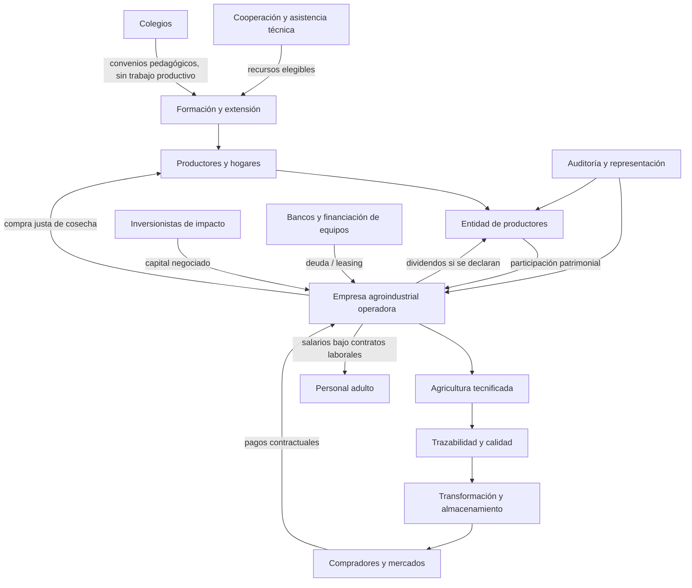

# Ecosistema de agroindustria con propiedad campesina

La estructura es conceptual y no supone que existan inversiones, acuerdos, constituciones societarias o dividendos. La educación escolar no debe sustituir trabajo remunerado.
