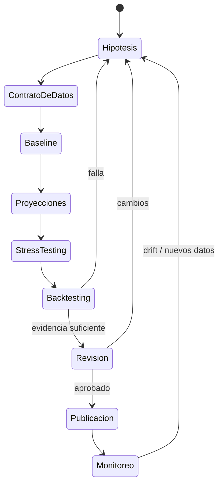

# Ciclo de vida de investigación cuantitativa

Cada corrida registra seed, versión, parámetros, horizonte, métricas, supuestos y artefactos. Las proyecciones son condicionales, no predicciones garantizadas.
