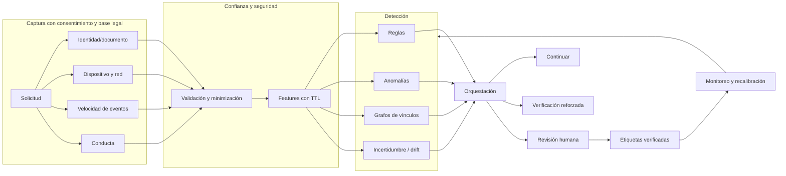

# Fraud and KYC — arquitectura multicapa

No usar señales sensibles o geolocalización sin fundamento legal, proporcionalidad, controles de retención y evaluación de sesgo. La salida es **riesgo para revisión**, no determinación automática de fraude.
