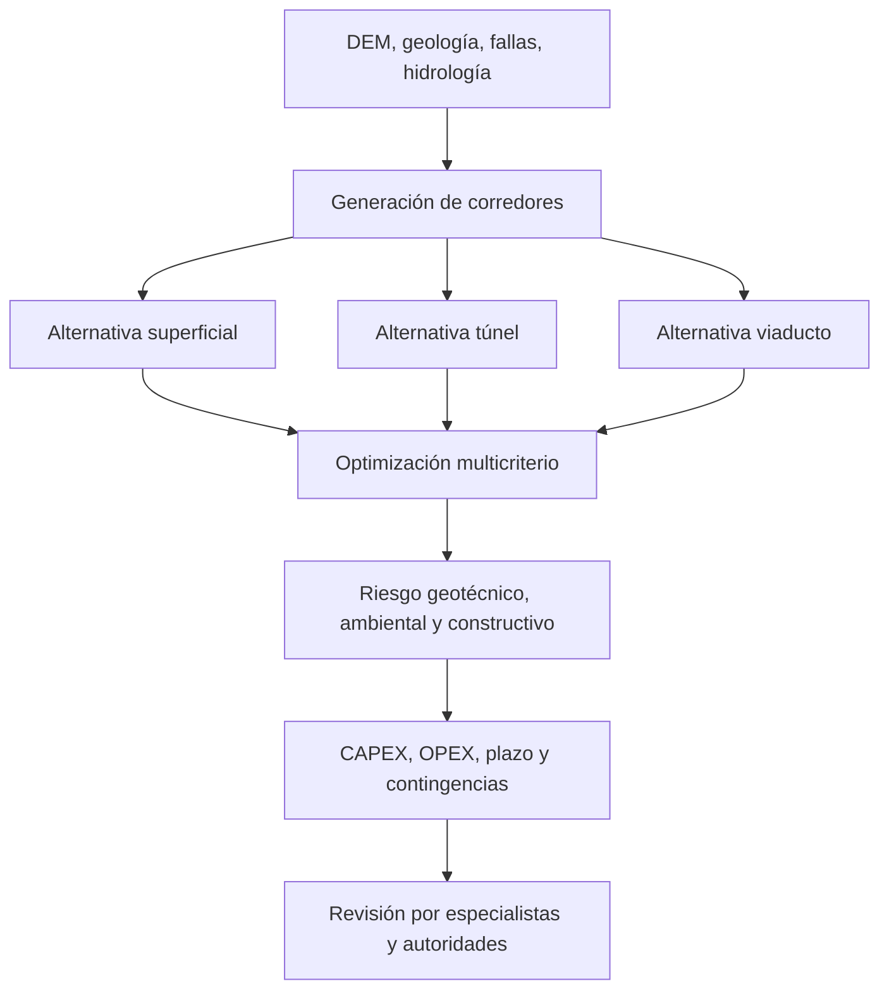

# Ingeniería ferroviaria en montaña — alternativas

Tecnologías candidatas según geología: TBM de roca dura, tuneladora EPB/slurry en suelos adecuados, NATM/SEM, perforación y voladura, viaductos segmentales y monitoreo instrumental. Ninguna tecnología es universal: seleccionar tras investigación geotécnica, hidrogeológica y sísmica.
