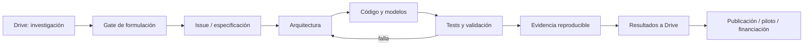

# Arquitectura del portafolio

## Capas comunes
Fuentes → ingestión/contratos → calidad → features → modelos → evaluación → decisión/visualización → auditoría.

Cada programa mantiene separación entre datos brutos, transformaciones, modelos y resultados. Los diagramas Mermaid son versionables; para arquitecturas complejas se incorporarán además fuentes editables draw.io.
