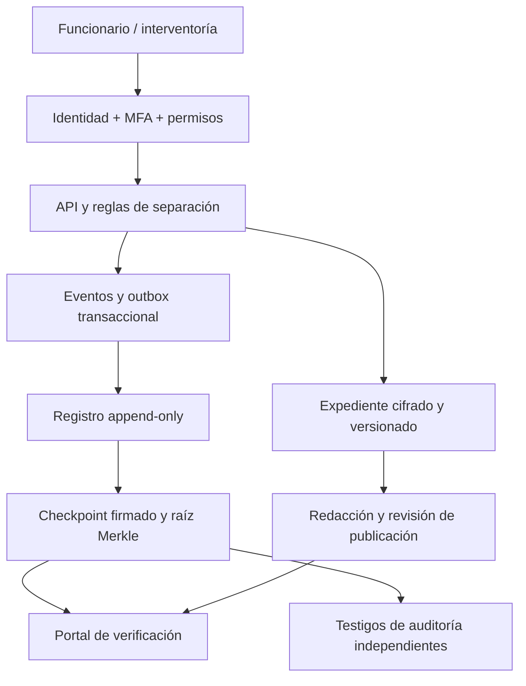
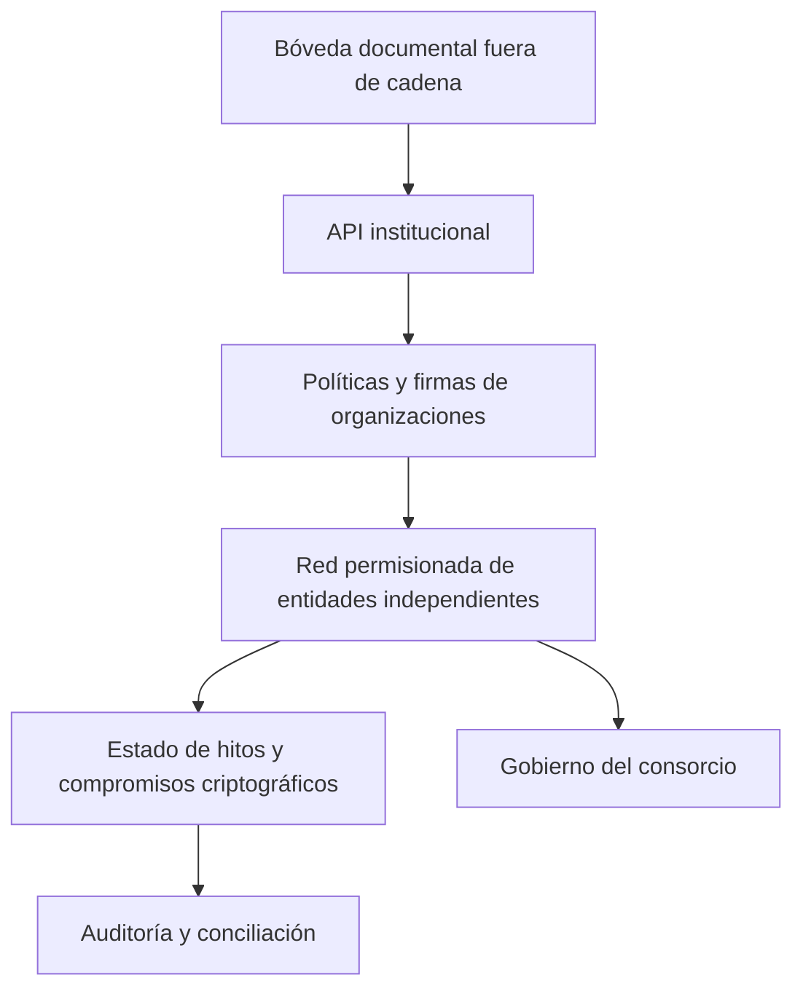
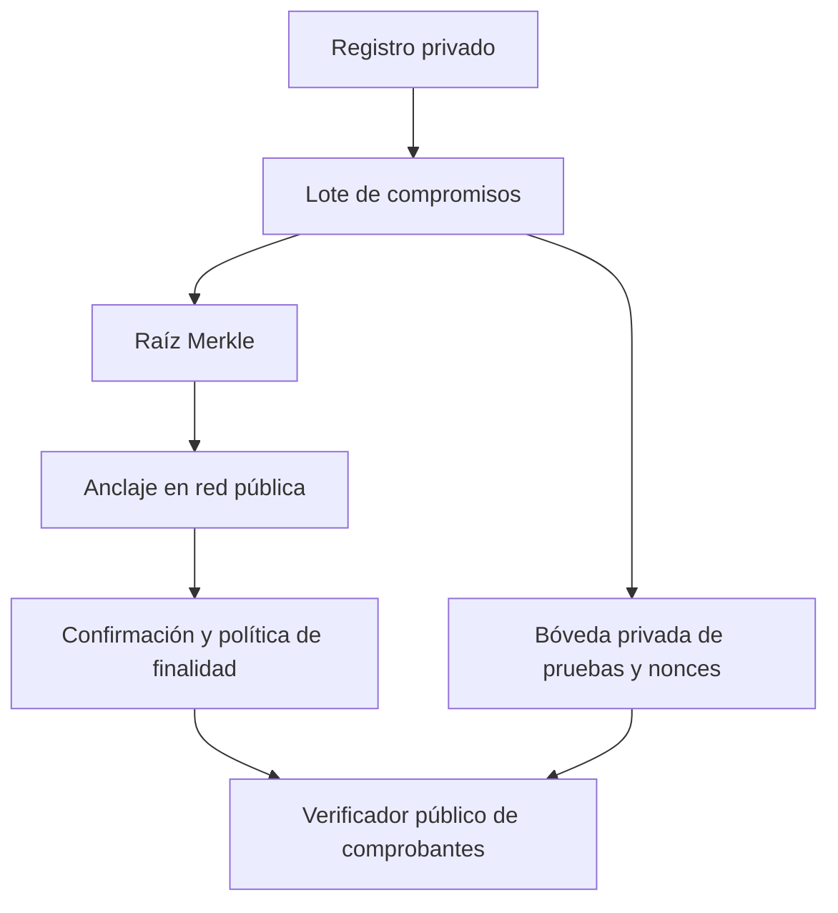

# Arquitecturas de Integridad Pública Verificable
Propuesta R2, 2026-10-24. Las tecnologías son candidatas, no sistemas contratados.

## A. Intranet con registro verificable — baseline del piloto

Candidatos: identidad OIDC, PostgreSQL para estado y outbox, almacenamiento de objetos
con retención WORM, servicio de firma con HSM/KMS y colector SIEM.
La operación de negocio y su evento se confirman en una transacción; un worker idempotente
publica el outbox. No afirmar atomicidad entre base, blockchain y banco.
Los testigos conservan checkpoints fuera del dominio administrativo de la entidad.
Separar planos de operación, auditoría y publicación; mTLS entre servicios, acceso mínimo,
gestión de dispositivos, revisión periódica de privilegios y recuperación ensayada.

## B. Consorcio blockchain permisionado

Evaluar Hyperledger Fabric como candidato: políticas de endorsement y datos privados
permiten diseñar quién respalda operaciones y quién recibe contenido. El consenso,
la disponibilidad del ordenamiento y la colusión requieren evaluación separada.
Proponer validación de interventoría y autorización institucional distintas; los operadores
del ledger no sustituyen a los responsables del contrato.
Definir incorporación y expulsión de nodos, administración de certificados, actualizaciones,
resolución de controversias, costes y quórums. Varias máquinas bajo un mismo administrador
no proporcionan independencia institucional.
Elegir esta opción sólo si existen varias organizaciones con interés y capacidad real de operar
y verificar el registro. Comparar con A bajo las mismas cargas y amenazas.

## C. Anclaje público híbrido

Publicar únicamente raíz de lote y versión de esquema; no documentos ni identificadores
personales. Para contenido predecible usar compromiso con nonce aleatorio secreto de alta
entropía, revelado sólo a verificadores autorizados. Un hash simple puede permitir adivinación.
Definir red, costes, finalidad, reorganizaciones, disponibilidad y procedimiento de contingencia
antes del piloto. Anclaje pendiente debe verse como pendiente, sin marcar confirmación ficticia.
El anclaje acredita compromiso verificable con datos; no una fecha legal ni la veracidad de la obra.

## Token de hito — diseño pendiente
Token no transferible, cantidad lógica uno por (contrato, hito), con versión de condiciones,
monto máximo en unidades monetarias enteras y enlace a expediente protegido.
Estados: REGISTRADO → EVIDENCIADO → VERIFICADO → AUTORIZADO → PAGADO → CONCILIADO.
DISPUTADO congela transiciones; resolución agrega evento y exige revisión independiente.
Una adición contractual crea nueva versión y autorización, nunca sobrescribe el límite.
Unicidad de emisión, control de concurrencia por versión, idempotencia por solicitud,
prevención de doble pago y conciliación bancaria son invariantes obligatorios.
El smart contract puede registrar elegibilidad; un conector autorizado solicita el pago y
su confirmación se registra después. Tiempo de espera no equivale a fracaso bancario:
reconsultar antes de reintentar. Sin puente automático a criptomonedas.

## Decisión inicial
Construir A como referencia. Probar B y C sólo contra una necesidad de confianza explícita.
Firmas y testigos se necesitan incluso si no se adopta blockchain. Credenciales verificables,
ZK, detección de colusión y gemelos de obra son líneas adicionales, no garantías implementadas.

## Fuentes técnicas
- [RFC 9162, árboles Merkle y transparencia](https://www.rfc-editor.org/rfc/rfc9162.html).
- [Fabric, endorsement](https://github.com/hyperledger/fabric/blob/main/docs/source/endorsement-policies.rst).
- [Fabric, datos privados](https://hyperledger-fabric.readthedocs.io/en/release-2.5/private-data-arch.html).

Las fuentes respaldan mecanismos técnicos; el diseño institucional y su efectividad son hipótesis del proyecto.
