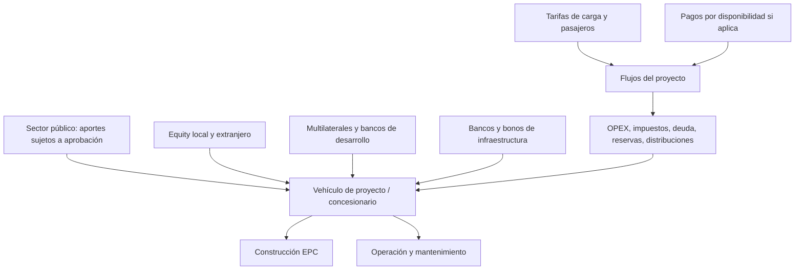

# Financiación ferroviaria y participación extranjera

Evaluar separadamente riesgo cambiario, demanda, construcción, ambiental, regulatorio, contraparte, garantías y contingencias fiscales. La inversión extranjera requiere due diligence de beneficiario final, jurisdicción, contratación, permisos y mecanismos de repatriación.
