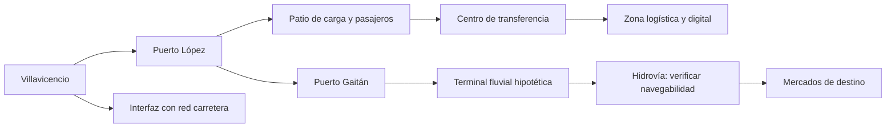

# Esquema conceptual de red y puertos

Este esquema representa conectividad funcional, no coordenadas, alineamiento ni infraestructura existente. Para puertos marítimos, modelar nodos alternativos y conexión terrestre por corredor independiente; no asumir enlace férreo continuo.
