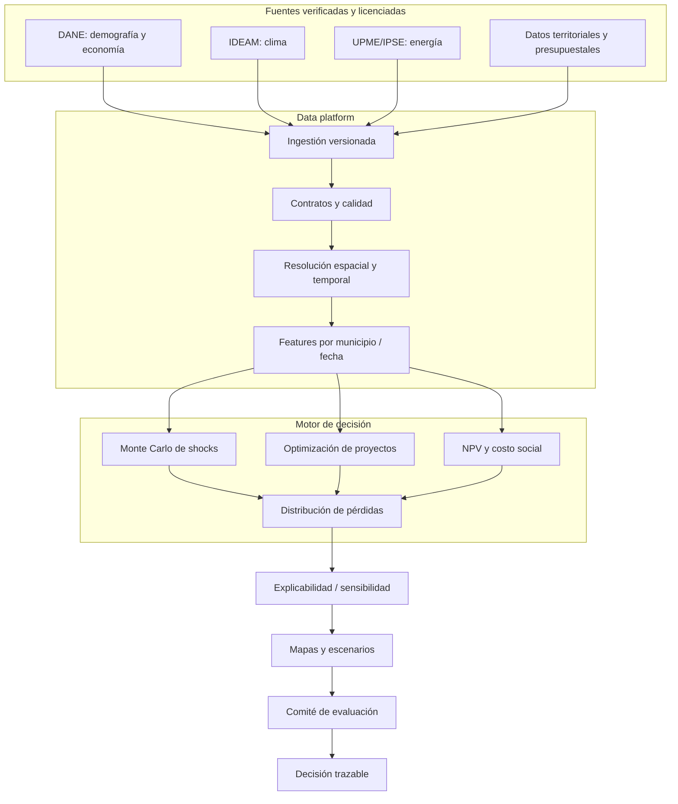

# Territorial digital twin — arquitectura de referencia

**Grano:** municipio × período × fuente. **Controles:** fecha de corte, licencia, completitud, revisiones de series, CRS, validación de rango y consistencia de unidades. **No es un gemelo digital operacional** hasta integrar actualización periódica y validación contra observaciones.
