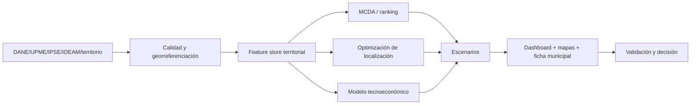

# Programa 01 — Desarrollo territorial y económico

Fuente inicial: documento **Desarrollo Económico / NOVDE** en Drive.

## Cartera inicial
1. Atlas multicriterio de oportunidad territorial.
2. Optimizador de localización de microredes y nodos digitales.
3. Modelo tecnoeconómico solar + almacenamiento + biomasa.
4. Simulador de impacto local: empleo, productividad, conectividad y acceso energético.
5. Motor de priorización SGR/cofinanciación con restricciones presupuestales.
6. Stress test climático y de continuidad energética.
7. Digital twin territorial para escenarios de infraestructura.

## Arquitectura

Primera exigencia: verificar cifras, cobertura, potencial energético y restricciones ambientales antes de parametrizar modelos.
