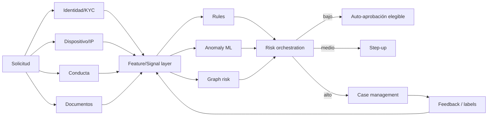

# Programa 02 — Fraude, identidad y KYC

Fuente inicial: documento **Fraude** en Drive.

## Cartera inicial
1. Motor de anomalías de originación multimodal.
2. Device/IP/geovelocity risk graph.
3. Detección de identidad sintética mediante grafos.
4. Liveness/deepfake risk orchestration (sin almacenar biometría real en el repo).
5. Behavioral biometrics simulator con datos sintéticos.
6. Network fraud / mule detection con GNN y baselines clásicos.
7. Case-management prioritization y explainability.
8. Adversarial red-team simulator para medir degradación del stack antifraude.

## Arquitectura de defensa

## Archivos del programa
- `architecture/`: arquitectura del stack antifraude.
- `notebooks/`: contrafactuales por señal y proyección de cartera.
- `python/colombia_dev/`, `cpp/`: modelos y prototipos.
- `tests/`: pruebas del código del programa.

Toda cifra de prevalencia o precisión citada en investigación debe validarse contra fuente primaria antes de usarse como benchmark.
