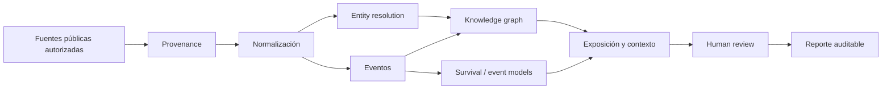

# Programa 03 — Riesgo y analítica judicial

La fuente de Drive **Procesos Judiciales** está actualmente sin contenido sustantivo recuperable; esta cartera es una formulación inicial, no una afirmación sobre capacidades existentes.

## Cartera inicial
1. Taxonomía de procesos y eventos judiciales.
2. Pipeline de datos públicos con provenance y control de cambios.
3. Entity resolution de personas jurídicas con salvaguardas.
4. Modelo de duración/supervivencia hasta hitos procesales.
5. Estimación probabilística de exposición económica por escenario.
6. Knowledge graph de relaciones proceso–parte–evento–jurisdicción.
7. Motor de alertas por cambio material, no por perfilamiento sensible.

## Esquema

No automatizar conclusiones legales ni decisiones adversas sobre personas. Requiere revisión jurídica, protección de datos y human-in-the-loop.
